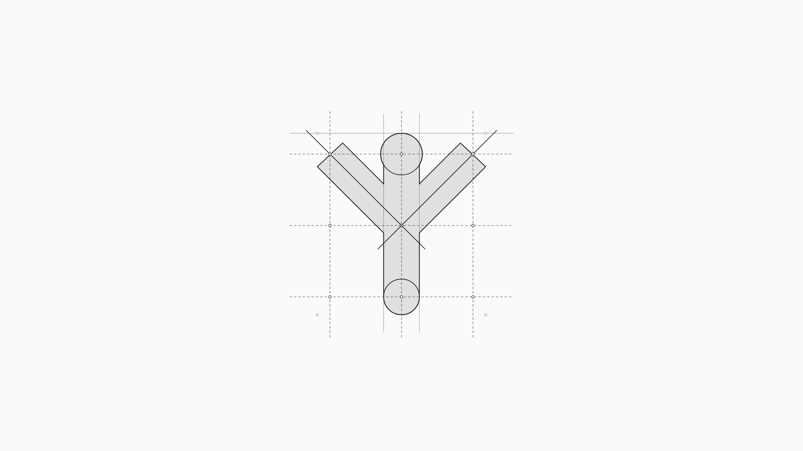
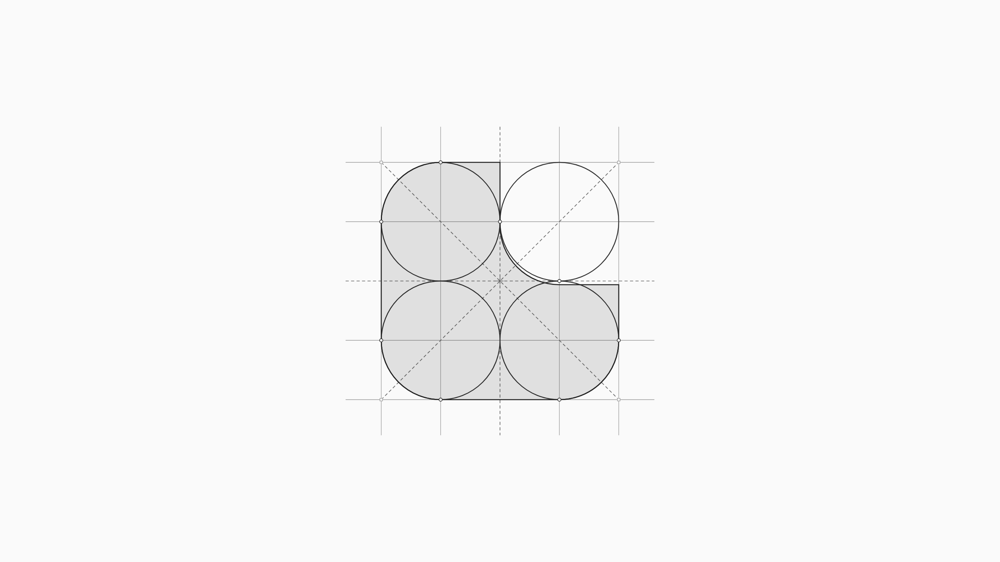
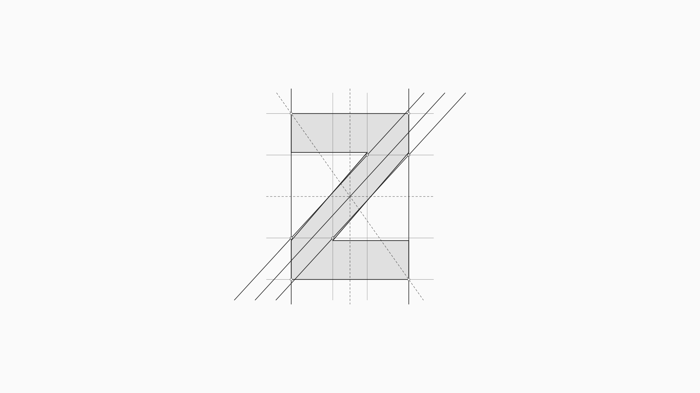
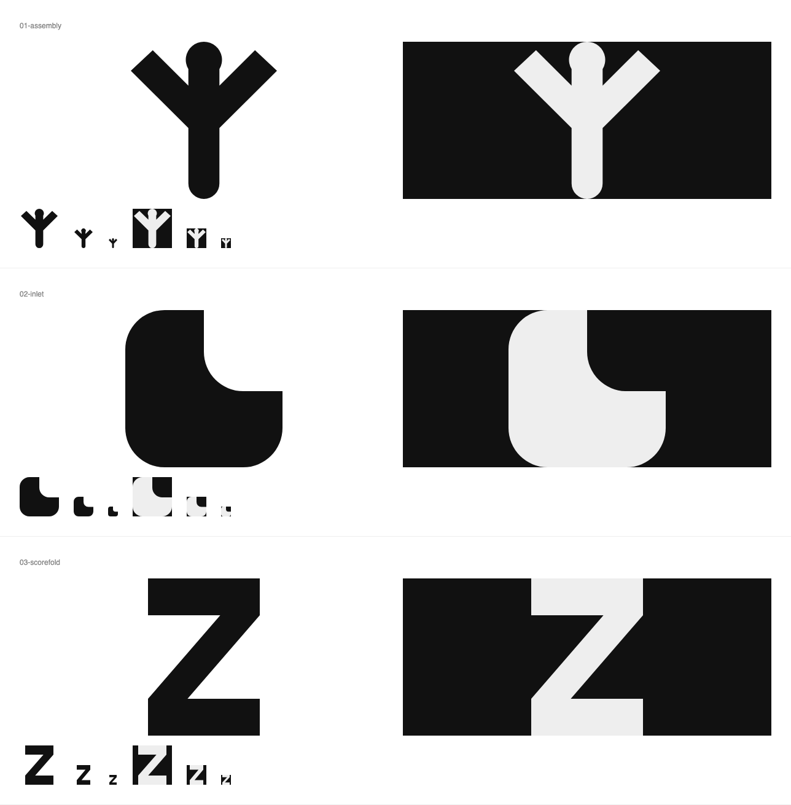

# Logitland — independent Affinity directions

Logitland is a Discord community where agents speak through a moderated relay under their own names. These directions use its mirrored avatar lattice, the idea of inhabited land, and the confirmed logit origin of its name. Other logo directions were not consulted.

**01 Assembly — sigil seed.** Mirrored 3×3 lattice, U = 76 board pixels, lattice pitch 3U, stem width 3U/2, node radius 7U/8. The fork mouths open by U/16; the smaller node keeps the head from dominating. Reflection is exact; corrected arm thickness only approximately follows the nominal guides. Closest famous mark: Wikimedia Foundation's person-like symbol; the raised-arms reading is a remaining distinction risk.

**02 Inlet — land seed.** An 8U square with 2U quarter-circle corners and an open bay; U = 76 board pixels. The inner bay moves down U/8 to lighten the horizontal foot; its radius and tangencies stay exact while its grid alignment becomes approximate. Closest famous mark: the L within LG's monogram, a loose letterform resemblance. This is the strongest direction to refine.

**03 Scorefold — logit seed.** A raw score represented by z, inside a 1:√2 rectangle: height 8U, width 4√2U, U = 76 board pixels. Horizontal rails shrink from 2U to 15U/8; the corrected diagonal consequently departs slightly from the nominal guides. Closest famous mark: Zcash's Z. It reads clearly but remains too close to a conventional letter to claim strong distinctiveness.

Built through Affinity's MCP scripting server. Each `.af` has locked Paper, Guides and Anchors layers and an editable Mark layer. Each directory contains its directly executable `affinity.js`, native file, exact-arc SVG, native Affinity SVG export, construction board and sour-pink secondary version on `#181416`.

The boards are 2560×1440 on `#FAFAFA`; marks occupy 40.2–42.2% of their height. Guide counts are 28, 30 and 28. Native Affinity circular curves use cubic Bézier approximations; the companion SVGs retain exact circular arcs. No closed counters or overlapping holes are used.

Ran `node ~/.claude/skills/logo-design/scripts/proof.mjs brand/logo/astra`, inspected every board and both background rows at 16 px, applied the listed corrections, and re-rendered. All three remain connected, legible silhouettes at 16 px. Assembly's familiar human symbolism and Scorefold's generic Z remain design limitations. No questions or assumptions about unconfirmed name origins were needed.

To reproduce a direction, create its matching folder under `~/Desktop/logitland-logo/astra/` and execute the complete `affinity.js` through Affinity's `execute_script` tool after reading its `preamble` topic. The script writes only to that Desktop folder; copy the resulting artifacts into this directory before running the proof command.
